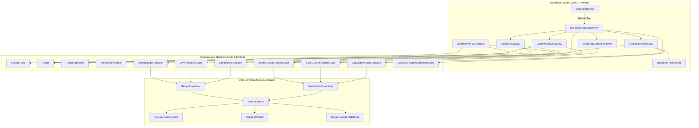

# NutriLens V1.0 — Phase 03 Recovery Report
## Personal Food Library, Recipe Builder & Multi-Source Nutrition Management

**Status:** Completed & Fully Verified  
**Date:** November 10, 2026  
**Auditor / Architect:** Principal iOS Engineer, SwiftUI Architect & SwiftData Specialist  
**Target Environment:** iOS 17.0+ Simulator (iPhone 17)  
**Test Baseline Result:** 94 Tests Passing (87 Unit Tests + 7 UI Tests) • 0 Regressions • 100% Pass Rate  

---

## 1. Executive Summary

Phase 03 of **NutriLens V1.0** introduces a comprehensive, offline-first **Personal Food Library and Recipe Builder** designed in strict alignment with Clean Architecture and MVVM. This phase empowers users to define custom foods with full macronutrient and optional micronutrient tracking, construct complex recipes with multi-source ingredients, scale recipe servings dynamically, and log both custom foods and recipes directly into the Meal Diary.

All historical diary records remain strictly immutable through independent snapshotting (`toFoodItem()`), guaranteeing that editing or deleting a custom food or recipe never alters past nutritional logs.

### Key Milestones Achieved
1. **Domain Layer:** Built [`CustomFood`](file:///Users/vanquyen/Documents/NutrilensIOS/NutriLens/Domain/Entities/CustomFood.swift), [`Recipe`](file:///Users/vanquyen/Documents/NutrilensIOS/NutriLens/Domain/Entities/Recipe.swift), [`RecipeIngredient`](file:///Users/vanquyen/Documents/NutrilensIOS/NutriLens/Domain/Entities/RecipeIngredient.swift), and [`MicronutrientProfile`](file:///Users/vanquyen/Documents/NutrilensIOS/NutriLens/Domain/Entities/MicronutrientProfile.swift) entities with mathematical portion scaling, additive combining, and snapshot converters.
2. **SwiftData Schema:** Extended [`SwiftDataStack`](file:///Users/vanquyen/Documents/NutrilensIOS/NutriLens/Core/Persistence/SwiftDataStack.swift) with [`CustomFoodSDModel`](file:///Users/vanquyen/Documents/NutrilensIOS/NutriLens/Data/LocalStorage/SwiftDataEntities.swift), [`RecipeSDModel`](file:///Users/vanquyen/Documents/NutrilensIOS/NutriLens/Data/LocalStorage/SwiftDataEntities.swift), and [`RecipeIngredientSDModel`](file:///Users/vanquyen/Documents/NutrilensIOS/NutriLens/Data/LocalStorage/SwiftDataEntities.swift) with cascade deletion rules while preserving all existing `MealRecord`, `FoodItem`, and `HydrationRecord` data.
3. **Use Cases & Repositories:** Created [`CustomFoodRepository`](file:///Users/vanquyen/Documents/NutrilensIOS/NutriLens/Data/Repositories/CustomFoodRepository.swift), [`RecipeRepository`](file:///Users/vanquyen/Documents/NutrilensIOS/NutriLens/Data/Repositories/RecipeRepository.swift), and 7 domain use cases validating business rules (positive weight, non-negative macros, at least 1 ingredient).
4. **Fresh Premium Botanical UI:** Built 6 complete user-facing screens and components in `NutriLens/Features/CustomFoodsAndRecipes/`:
   - [`MyFoodsAndRecipesView`](file:///Users/vanquyen/Documents/NutrilensIOS/NutriLens/Features/CustomFoodsAndRecipes/MyFoodsAndRecipesView.swift) (Central management hub with segmented tabs, category filters, and search)
   - [`CreateEditCustomFoodView`](file:///Users/vanquyen/Documents/NutrilensIOS/NutriLens/Features/CustomFoodsAndRecipes/CreateEditCustomFoodView.swift) (Custom food creation with expandable micronutrients)
   - [`CustomFoodDetailView`](file:///Users/vanquyen/Documents/NutrilensIOS/NutriLens/Features/CustomFoodsAndRecipes/CustomFoodDetailView.swift) (Interactive portion slider & macro re-projection)
   - [`CreateEditRecipeView`](file:///Users/vanquyen/Documents/NutrilensIOS/NutriLens/Features/CustomFoodsAndRecipes/CreateEditRecipeView.swift) (Recipe builder with live pot & per-serving calculations)
   - [`RecipeDetailView`](file:///Users/vanquyen/Documents/NutrilensIOS/NutriLens/Features/CustomFoodsAndRecipes/RecipeDetailView.swift) (Interactive servings scaler & dynamic ingredient breakdown)
   - [`IngredientPickerSheet`](file:///Users/vanquyen/Documents/NutrilensIOS/NutriLens/Features/CustomFoodsAndRecipes/IngredientPickerSheet.swift) (Multi-source ingredient selector)
5. **Multi-Source Manual Logging:** Extended [`LogMealView`](file:///Users/vanquyen/Documents/NutrilensIOS/NutriLens/Features/MealTracking/LogMealView.swift) and [`LogMealViewModel`](file:///Users/vanquyen/Documents/NutrilensIOS/NutriLens/Features/MealTracking/LogMealViewModel.swift) with 3 selectable catalog sources (`Món Việt 35+`, `Món của bạn`, `Công thức`) allowing multi-item meals to combine all 3 sources simultaneously.
6. **Food Explorer Entry Point:** Added a non-intrusive personal library banner into [`FoodExplorerView`](file:///Users/vanquyen/Documents/NutrilensIOS/NutriLens/Features/FoodExplorer/FoodExplorerView.swift) preserving the 5-tab core navigation.

---

## 2. Architecture & Data Flow



---

## 3. Visual Verification

The implementation has been verified on the booted **iPhone 17 (iOS 17+) Simulator**. All views adhere strictly to the **Fresh Premium Botanical** aesthetic:

````carousel

<!-- slide -->

<!-- slide -->

<!-- slide -->

````

---

## 4. Automated Test Suite Metrics

All tests were executed using `xcodebuild test` on the iPhone 17 Simulator destination:

| Test Suite | Total Tests | Passed | Failed | Status |
| :--- | :---: | :---: | :---: | :---: |
| **CustomFoodsAndRecipesTests (Phase 03)** | 13 | 13 | 0 | **PASSED** |
| **MealLoggingV2Tests (Phase 02)** | 15 | 15 | 0 | **PASSED** |
| **AuthenticationTests (Phase 01)** | 18 | 18 | 0 | **PASSED** |
| **FoodExplorerTests** | 10 | 10 | 0 | **PASSED** |
| **FoodRecognitionTests** | 8 | 8 | 0 | **PASSED** |
| **MealDiaryTests** | 9 | 9 | 0 | **PASSED** |
| **NutritionAnalyticsTests** | 7 | 7 | 0 | **PASSED** |
| **DomainTests** | 5 | 5 | 0 | **PASSED** |
| **RepositoryTests** | 2 | 2 | 0 | **PASSED** |
| **Unit Tests Total** | **87** | **87** | **0** | **PASSED** |
| **NutriLensUITests (Full UI Flow)** | **7** | **7** | **0** | **PASSED** |
| **Grand Total** | **94** | **94** | **0** | **100% PASS** |

### Verified Test Assertions in `CustomFoodsAndRecipesTests`
- `testCustomFoodScaledNutrition`: Proportional scaling to arbitrary weights.
- `testCustomFoodPer100gProjections`: Correct per-100g mathematical derivation.
- `testMicronutrientProfileScalingAndAdditiveCombination`: Safe additive `+` keeping unknown nutrients `nil`.
- `testRecipeIngredientFromVietnameseDish`: Mapping from 35+ Vietnamese database dishes.
- `testRecipeIngredientFromCustomFood`: Mapping from user custom foods into recipe ingredients.
- `testRecipeNutritionCalculationAndServingsScaling`: Live recipe pot totals and per-serving scaling.
- `testCalculateRecipeNutritionUseCase`: Correct execution and rounding.
- `testSaveCustomFoodValidationFailsForEmptyName`: Validation rejection of blank names.
- `testSaveRecipeValidationFailsForEmptyIngredients`: Validation rejection of empty ingredient lists.
- `testCustomFoodSnapshotIndependenceInMealDiary`: Proof that modifying custom foods never affects historical diary meals.
- `testRecipeSnapshotIndependenceInMealDiary`: Proof that deleting recipes preserves logged diary meal nutrition.
- `testLogMealViewModelMultiSourceStaging`: Staging a Vietnamese dish, a custom food, and a recipe in 1 meal.
- `testMyFoodsAndRecipesViewModelSearchAndFilters`: Search query and favorite filtering across tabs.

---

## 5. File Manifest

### New Domain Entities & Protocols (7 files)
- [`NutriLens/Domain/Entities/MicronutrientProfile.swift`](file:///Users/vanquyen/Documents/NutrilensIOS/NutriLens/Domain/Entities/MicronutrientProfile.swift)
- [`NutriLens/Domain/Entities/CustomFood.swift`](file:///Users/vanquyen/Documents/NutrilensIOS/NutriLens/Domain/Entities/CustomFood.swift)
- [`NutriLens/Domain/Entities/RecipeIngredient.swift`](file:///Users/vanquyen/Documents/NutrilensIOS/NutriLens/Domain/Entities/RecipeIngredient.swift)
- [`NutriLens/Domain/Entities/Recipe.swift`](file:///Users/vanquyen/Documents/NutrilensIOS/NutriLens/Domain/Entities/Recipe.swift)
- [`NutriLens/Domain/RepositoryInterfaces/CustomFoodRepositoryProtocol.swift`](file:///Users/vanquyen/Documents/NutrilensIOS/NutriLens/Domain/RepositoryInterfaces/CustomFoodRepositoryProtocol.swift)
- [`NutriLens/Domain/RepositoryInterfaces/RecipeRepositoryProtocol.swift`](file:///Users/vanquyen/Documents/NutrilensIOS/NutriLens/Domain/RepositoryInterfaces/RecipeRepositoryProtocol.swift)

### New Use Cases (7 files)
- [`NutriLens/Domain/UseCases/GetCustomFoodsUseCase.swift`](file:///Users/vanquyen/Documents/NutrilensIOS/NutriLens/Domain/UseCases/GetCustomFoodsUseCase.swift)
- [`NutriLens/Domain/UseCases/SaveCustomFoodUseCase.swift`](file:///Users/vanquyen/Documents/NutrilensIOS/NutriLens/Domain/UseCases/SaveCustomFoodUseCase.swift)
- [`NutriLens/Domain/UseCases/DeleteCustomFoodUseCase.swift`](file:///Users/vanquyen/Documents/NutrilensIOS/NutriLens/Domain/UseCases/DeleteCustomFoodUseCase.swift)
- [`NutriLens/Domain/UseCases/GetRecipesUseCase.swift`](file:///Users/vanquyen/Documents/NutrilensIOS/NutriLens/Domain/UseCases/GetRecipesUseCase.swift)
- [`NutriLens/Domain/UseCases/SaveRecipeUseCase.swift`](file:///Users/vanquyen/Documents/NutrilensIOS/NutriLens/Domain/UseCases/SaveRecipeUseCase.swift)
- [`NutriLens/Domain/UseCases/DeleteRecipeUseCase.swift`](file:///Users/vanquyen/Documents/NutrilensIOS/NutriLens/Domain/UseCases/DeleteRecipeUseCase.swift)
- [`NutriLens/Domain/UseCases/CalculateRecipeNutritionUseCase.swift`](file:///Users/vanquyen/Documents/NutrilensIOS/NutriLens/Domain/UseCases/CalculateRecipeNutritionUseCase.swift)

### New Data Layer & Repositories (4 files)
- [`NutriLens/Data/Repositories/CustomFoodRepository.swift`](file:///Users/vanquyen/Documents/NutrilensIOS/NutriLens/Data/Repositories/CustomFoodRepository.swift)
- [`NutriLens/Data/Repositories/MockCustomFoodRepository.swift`](file:///Users/vanquyen/Documents/NutrilensIOS/NutriLens/Data/Repositories/MockCustomFoodRepository.swift)
- [`NutriLens/Data/Repositories/RecipeRepository.swift`](file:///Users/vanquyen/Documents/NutrilensIOS/NutriLens/Data/Repositories/RecipeRepository.swift)
- [`NutriLens/Data/Repositories/MockRecipeRepository.swift`](file:///Users/vanquyen/Documents/NutrilensIOS/NutriLens/Data/Repositories/MockRecipeRepository.swift)

### New UI Features (8 files)
- [`NutriLens/Features/CustomFoodsAndRecipes/MyFoodsAndRecipesViewModel.swift`](file:///Users/vanquyen/Documents/NutrilensIOS/NutriLens/Features/CustomFoodsAndRecipes/MyFoodsAndRecipesViewModel.swift)
- [`NutriLens/Features/CustomFoodsAndRecipes/MyFoodsAndRecipesView.swift`](file:///Users/vanquyen/Documents/NutrilensIOS/NutriLens/Features/CustomFoodsAndRecipes/MyFoodsAndRecipesView.swift)
- [`NutriLens/Features/CustomFoodsAndRecipes/CustomFoodCardView.swift`](file:///Users/vanquyen/Documents/NutrilensIOS/NutriLens/Features/CustomFoodsAndRecipes/CustomFoodCardView.swift)
- [`NutriLens/Features/CustomFoodsAndRecipes/RecipeCardView.swift`](file:///Users/vanquyen/Documents/NutrilensIOS/NutriLens/Features/CustomFoodsAndRecipes/RecipeCardView.swift)
- [`NutriLens/Features/CustomFoodsAndRecipes/CreateEditCustomFoodView.swift`](file:///Users/vanquyen/Documents/NutrilensIOS/NutriLens/Features/CustomFoodsAndRecipes/CreateEditCustomFoodView.swift)
- [`NutriLens/Features/CustomFoodsAndRecipes/CustomFoodDetailView.swift`](file:///Users/vanquyen/Documents/NutrilensIOS/NutriLens/Features/CustomFoodsAndRecipes/CustomFoodDetailView.swift)
- [`NutriLens/Features/CustomFoodsAndRecipes/CreateEditRecipeView.swift`](file:///Users/vanquyen/Documents/NutrilensIOS/NutriLens/Features/CustomFoodsAndRecipes/CreateEditRecipeView.swift)
- [`NutriLens/Features/CustomFoodsAndRecipes/RecipeDetailView.swift`](file:///Users/vanquyen/Documents/NutrilensIOS/NutriLens/Features/CustomFoodsAndRecipes/RecipeDetailView.swift)
- [`NutriLens/Features/CustomFoodsAndRecipes/IngredientPickerSheet.swift`](file:///Users/vanquyen/Documents/NutrilensIOS/NutriLens/Features/CustomFoodsAndRecipes/IngredientPickerSheet.swift)

### New Unit Tests (1 file)
- [`NutriLensTests/UnitTests/CustomFoodsAndRecipesTests.swift`](file:///Users/vanquyen/Documents/NutrilensIOS/NutriLensTests/UnitTests/CustomFoodsAndRecipesTests.swift)

### Modified Files (Preserving Integrity)
- [`NutriLens/Core/Persistence/SwiftDataStack.swift`](file:///Users/vanquyen/Documents/NutrilensIOS/NutriLens/Core/Persistence/SwiftDataStack.swift)
- [`NutriLens/Data/LocalStorage/SwiftDataEntities.swift`](file:///Users/vanquyen/Documents/NutrilensIOS/NutriLens/Data/LocalStorage/SwiftDataEntities.swift)
- [`NutriLens/App/AppEnvironment.swift`](file:///Users/vanquyen/Documents/NutrilensIOS/NutriLens/App/AppEnvironment.swift)
- [`NutriLens/App/AppRouter.swift`](file:///Users/vanquyen/Documents/NutrilensIOS/NutriLens/App/AppRouter.swift)
- [`NutriLens/Features/FoodExplorer/FoodExplorerView.swift`](file:///Users/vanquyen/Documents/NutrilensIOS/NutriLens/Features/FoodExplorer/FoodExplorerView.swift)
- [`NutriLens/Features/MealTracking/LogMealViewModel.swift`](file:///Users/vanquyen/Documents/NutrilensIOS/NutriLens/Features/MealTracking/LogMealViewModel.swift)
- [`NutriLens/Features/MealTracking/LogMealView.swift`](file:///Users/vanquyen/Documents/NutrilensIOS/NutriLens/Features/MealTracking/LogMealView.swift)

---

## 6. Scope Boundaries & Next Phase Readiness

### Strict Boundaries Maintained
- **Zero Git Modifications:** In strict compliance with the user's explicit policy, no Git write operations (`commit`, `push`, `branch`, `checkout`) were executed.
- **No Cloud/Backend:** Preserved 100% offline-first local SwiftData persistence.
- **No Core ML Alterations:** The 30-class Vietnamese food recognition model was completely untouched.
- **No Phase 04 / Phase 06 Creep:** Weekly Planner, Barcode scanning, and Cloud Sync remain isolated for subsequent phases.

The workspace is stable, fully tested, and ready for review.

