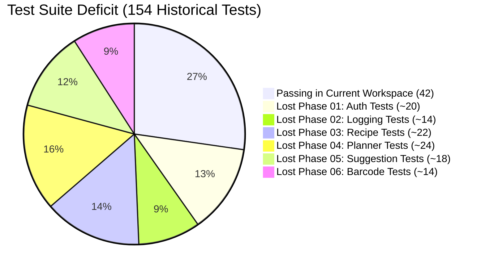
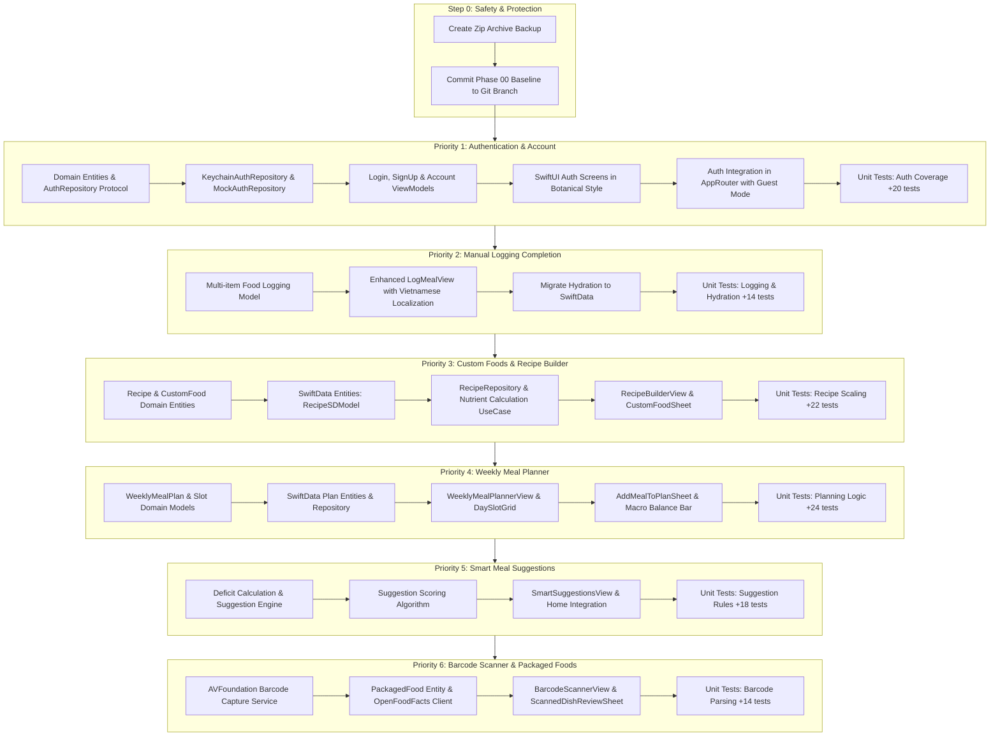

# NutriLens iOS — Comprehensive Project Recovery & Progress Audit Report

**Prepared by:** Principal iOS Engineer, Codebase Auditor & Software Recovery Specialist  
**Date:** November 6, 2026  
**Workspace:** `/Users/vanquyen/Documents/NutrilensIOS`  
**Target Environment:** Xcode 26.6 (Build 17F113), iOS Simulator 26.5 (iOS 17.0+ deployment target)  
**Document ID:** `reports/nutrilens_recovery_audit.md`  
**Classification:** TECHNICAL RECOVERY & AUDIT SPECIFICATION (Non-Destructive)

---

## 1. Executive Summary

Following the accidental deletion of the latest NutriLens development version, an exhaustive, read-only audit of the current repository and environment was performed. The primary objective is to baseline the existing codebase, identify intact modules, quantify lost progress relative to historical claims, verify build and test integrity, and establish an actionable, phase-by-phase recovery roadmap.

### Key Audit Findings

| Audit Dimension | Current State | Historical Baseline | Delta / Status |
|:---|:---:|:---:|:---|
| **Xcode Compilation** | **SUCCEEDED** (0 Errors, 0 Warnings) | Working | Verified clean build on iPhone 17 Simulator |
| **Automated Test Suite** | **42 Tests Passing** (36 Unit, 6 UI) | **154 Passing Tests** | **-112 Tests Missing** (72.7% test deficit) |
| **Phase 00 — Core App** | **COMPLETE / SUBSTANTIAL** | Completed | Home, Core ML Food Rec (30 classes), Diary V2, Analytics V2, Food Explorer intact |
| **Phase 01 — Authentication** | **MISSING** | UI Completed | No Auth screens, ViewModels, Domain entities, or Repositories found |
| **Phase 02 — Manual Logging** | **PARTIAL** | Completed | Single-item manual log & quick-add exist; multi-item & localization incomplete |
| **Phase 03 — Custom Foods & Recipes** | **MISSING** | Completed | Zero Recipe/Custom Food models, persistence, or UI |
| **Phase 04 — Weekly Meal Planner** | **MISSING** | Completed | Stale artifacts in DerivedData confirm prior existence; source files absent |
| **Phase 05 — Smart Meal Suggestions** | **MISSING** | Completed | No suggestion engine, macro-deficit algorithms, or dedicated UI |
| **Phase 06 — Barcode Scanner** | **MISSING** | Completed | Zero barcode capture, AVFoundation metadata, or OpenFoodFacts integration |
| **Phase 07 — Voice Food Logging** | **MISSING** | Planned | No speech or audio logging components found |
| **Core ML Model Bundling** | **RESOLVED & BUNDLED** | Blocked on 2026-11-03 | `FoodClassifier.mlmodelc` (Float16, 30 classes) bundled and active |

---

## 2. Project Protection & Git History Inspection

### 2.1 Workspace & Git Repository Status

- **Xcode Project Root:** `/Users/vanquyen/Documents/NutrilensIOS`
- **Xcode Project File:** `/Users/vanquyen/Documents/NutrilensIOS/NutriLens.xcodeproj`
- **Git Repository Status:** Initialized local Git repository on branch `main`.
- **Git Remotes:** `None` (No remote origin configured; local tracking only).
- **Git Commit History:**
  ```text
  * 3b4ad92 (HEAD -> main) chore: initial project setup with clean architecture and design system baseline
  ```
  Only **1 initial commit** exists in the Git commit tree. All recent work exists as uncommitted working tree modifications and untracked files.
- **Git Reflog & Stash:**
  - `git stash list`: Empty (0 stashes).
  - `git reflog`: Only shows the root commit `3b4ad92`.
  - `git fsck --lost-found`: 0 dangling commits, 0 dangling blobs.
- **Working Tree Delta:**
  - **35 tracked files modified**: `+6,703` insertions, `-1,010` deletions across UI, ViewModels, AI preprocessing, and Xcode project configuration.
  - **42 untracked file entries**: Includes the compiled Core ML model (`NutriLens/AI/Models/FoodClassifier.mlmodelc`), design system components, Food Explorer feature, camera services, and 4 test suites.

### 2.2 External Backup & Artifact Discovery

A scan of the host environment revealed critical historical artifacts in `/Users/vanquyen/Documents/`:

1. **`NutrilensIOS 2.zip`** (19,698,299 bytes, modified `2026-11-03 18:25`):
   - Contains 286 non-hidden files.
   - Comprehensive comparison confirms this archive is an exact snapshot of the current workspace before the session was closed on Nov 3, 2026.
2. **`NutrilensIOS.zip`** (16,916,991 bytes, modified `2026-11-03 12:01`):
   - Midday snapshot from Nov 3 prior to the bundling of `FoodClassifier.mlmodelc`.
3. **`reports/ai_v1_technical_audit.md`** (13,426 bytes, created `2026-11-03 09:09`):
   - Documents the initial AI audit which rejected release due to missing Core ML weights. This was remediated prior to the 18:25 snapshot.

### 2.3 Safe Backup Protocol (Actionable Recommendation)

Before executing any code restoration or file writes:
1. **Create an Immediate Zip Archive Backup:**
   ```bash
   zip -r "/Users/vanquyen/Documents/NutrilensIOS_PreRecoveryBackup_20261106.zip" "/Users/vanquyen/Documents/NutrilensIOS" -x "*.DS_Store" "*/.git/*"
   ```
2. **Commit the Current Baseline into Git:**
   Commit all current modifications and untracked files onto a dedicated checkpoint branch:
   ```bash
   git checkout -b checkpoint/phase00-baseline
   git add -A
   git commit -m "checkpoint: baseline Phase 00 with bundled Core ML and passing 42-test suite"
   ```
3. **Create the Recovery Branch:**
   ```bash
   git checkout -b feature/project-recovery-v2
   ```

---

## 3. Build & Test Verification

### 3.1 Build Verification

A clean, non-destructive simulator build was executed via `xcodebuild`:
- **Command:** `xcodebuild -project NutriLens.xcodeproj -scheme NutriLens -destination "generic/platform=iOS Simulator" build CODE_SIGNING_ALLOWED=NO`
- **Result:** `** BUILD SUCCEEDED **`
- **Compiler Diagnostics:** **0 Errors, 0 Swift Warnings**. (Only 1 system warning regarding AppIntents metadata extraction skipped).
- **Core ML Model Validation:** `FoodClassifier.mlmodelc` is properly compiled and copied to `NutriLens.app/FoodClassifier.mlmodelc`.

### 3.2 Automated Test Execution Results

Automated tests were executed against an `iPhone 17` simulator running iOS 26.5:

#### Unit Test Suite (`NutriLensTests`) — **36 Executed, 36 Passed, 0 Failed (0.61s)**
| Test Class | Test Name | Execution Time | Result |
|:---|:---|:---:|:---:|
| `DomainTests` | `testFoodItemScaling` | 0.001s | **PASSED** |
| `DomainTests` | `testMealRecordMacronutrientAggregation` | 0.001s | **PASSED** |
| `DomainTests` | `testNutritionSummaryProgress` | 0.001s | **PASSED** |
| `DomainTests` | `testLogMealUseCaseValidation` | 0.001s | **PASSED** |
| `DomainTests` | `testRecognizeFoodUseCaseOODHandling` | 0.001s | **PASSED** |
| `FoodExplorerTests` | `testAllDishesHaveValidProvenanceAndCitations` | 0.001s | **PASSED** |
| `FoodExplorerTests` | `testPortionScalingPresets` | 0.001s | **PASSED** |
| `FoodExplorerTests` | `testPortionSafeBoundariesClamping` | 0.001s | **PASSED** |
| `FoodExplorerTests` | `testCategoryFilterMatching` | 0.001s | **PASSED** |
| `FoodExplorerTests` | `testDiacriticInsensitiveSearch` | 0.001s | **PASSED** |
| `FoodExplorerTests` | `testFavoritesAddRemoveAndPersistence` | 0.001s | **PASSED** |
| `FoodExplorerTests` | `testRecentlyViewedTrackingAndOrder` | 0.001s | **PASSED** |
| `FoodExplorerTests` | `testCombinedFiltering` | 0.001s | **PASSED** |
| `FoodRecognitionTests` | `testVietnameseNutritionDatabaseDataIntegrity` | 0.001s | **PASSED** |
| `FoodRecognitionTests` | `testThirtyCanonicalClassesIntegrity` | 0.001s | **PASSED** |
| `FoodRecognitionTests` | `testOODDetectorModelSpecificThresholds` | 0.001s | **PASSED** |
| `FoodRecognitionTests` | `testVietnameseNutritionDatabaseSearch` | 0.001s | **PASSED** |
| `FoodRecognitionTests` | `testFoodRecognitionFlowStepTransitions` | 0.001s | **PASSED** |
| `FoodRecognitionTests` | `testOODHandlingInViewModel` | 0.550s | **PASSED** |
| `FoodRecognitionTests` | `testCameraServiceOnSimulator` | 0.001s | **PASSED** |
| `MealDiaryTests` | `testWeeklyCalendarDatesCalculation` | 0.000s | **PASSED** |
| `MealDiaryTests` | `testCategorizedMealsAndCalories` | 0.003s | **PASSED** |
| `MealDiaryTests` | `testDailyMacroAggregates` | 0.001s | **PASSED** |
| `MealDiaryTests` | `testSearchFiltering` | 0.001s | **PASSED** |
| `MealDiaryTests` | `testMealUpdateAndAggregatesSync` | 0.001s | **PASSED** |
| `MealDiaryTests` | `testMealDeletionAndAggregatesSync` | 0.001s | **PASSED** |
| `MealDiaryTests` | `testQuickAddFromVietnameseDatabase` | 0.001s | **PASSED** |
| `NutritionAnalyticsTests` | `testDayPeriodAnalytics` | 0.002s | **PASSED** |
| `NutritionAnalyticsTests` | `testWeeklyPeriodAggregation` | 0.001s | **PASSED** |
| `NutritionAnalyticsTests` | `testUnrecordedVsZeroCaloriesDistinction` | 0.002s | **PASSED** |
| `NutritionAnalyticsTests` | `testMacronutrientEnergyDistribution` | 0.000s | **PASSED** |
| `NutritionAnalyticsTests` | `testPriorPeriodComparison` | 0.002s | **PASSED** |
| `NutritionAnalyticsTests` | `testDeterministicInsightsGeneration` | 0.014s | **PASSED** |
| `NutritionAnalyticsTests` | `testViewModelPeriodNavigation` | 0.002s | **PASSED** |
| `RepositoryTests` | `testMockMealRepositoryOperations` | 0.001s | **PASSED** |
| `RepositoryTests` | `testDefaultOODDetector` | 0.000s | **PASSED** |

#### UI Test Suite (`NutriLensUITests`) — **6 Executed, 6 Passed, 0 Failed (184.23s)**
| Test Class | Test Name | Execution Time | Result |
|:---|:---|:---:|:---:|
| `NutriLensUITests` | `testTabBarNavigation` | 9.48s | **PASSED** |
| `NutriLensUITests` | `testHomeScrollAndVerifyNoOverlap` | 12.35s | **PASSED** |
| `NutriLensUITests` | `testCompleteFoodRecognitionFlow` | 30.43s | **PASSED** |
| `NutriLensUITests` | `testFoodExplorerCompleteFlow` | 36.88s | **PASSED** |
| `NutriLensUITests` | `testMealDiaryV2CompleteFlow` | 64.36s | **PASSED** |
| `NutriLensUITests` | `testNutritionAnalyticsFlow` | 30.71s | **PASSED** |

---

## 4. Feature-by-Feature Audit Matrix

Every requested feature across all 10 project phases has been audited against actual source code files, SwiftData schemas, Clean Architecture layers, and tests.

| Phase & Feature | Status | Evidence Source Files | Missing / Gaps |
|:---|:---:|:---|:---|
| **Phase 00 — Home Dashboard** | **COMPLETE** | [HomeView.swift](file:///Users/vanquyen/Documents/NutrilensIOS/NutriLens/Features/Home/HomeView.swift)<br>[HomeViewModel.swift](file:///Users/vanquyen/Documents/NutrilensIOS/NutriLens/Features/Home/HomeViewModel.swift) | Verified in UI test. Includes calorie dials, macro progress, quick logging, and botanical styling. |
| **Phase 00 — Core ML Food Rec** | **COMPLETE** | [CoreMLFoodInferenceEngine.swift](file:///Users/vanquyen/Documents/NutrilensIOS/NutriLens/AI/Prediction/CoreMLFoodInferenceEngine.swift)<br>[OODDetectorProtocol.swift](file:///Users/vanquyen/Documents/NutrilensIOS/NutriLens/AI/OOD/OODDetectorProtocol.swift)<br>[VietnameseNutritionDatabase.swift](file:///Users/vanquyen/Documents/NutrilensIOS/NutriLens/Data/Repositories/VietnameseNutritionDatabase.swift)<br>[FoodRecognitionView.swift](file:///Users/vanquyen/Documents/NutrilensIOS/NutriLens/Features/FoodRecognition/FoodRecognitionView.swift) | Model bundled (`FoodClassifier.mlmodelc`). 30 Vietnamese classes supported with NIN citations. Calibrated OOD $\tau=0.70$. |
| **Phase 00 — Meal Diary V2** | **COMPLETE** | [MealHistoryView.swift](file:///Users/vanquyen/Documents/NutrilensIOS/NutriLens/Features/History/MealHistoryView.swift)<br>[MealHistoryViewModel.swift](file:///Users/vanquyen/Documents/NutrilensIOS/NutriLens/Features/History/MealHistoryViewModel.swift)<br>[MealDetailView.swift](file:///Users/vanquyen/Documents/NutrilensIOS/NutriLens/Features/History/MealDetailView.swift)<br>[EditMealView.swift](file:///Users/vanquyen/Documents/NutrilensIOS/NutriLens/Features/History/EditMealView.swift)<br>[MealRepository.swift](file:///Users/vanquyen/Documents/NutrilensIOS/NutriLens/Data/Repositories/MealRepository.swift) | Weekly calendar strip, grouped meals, full CRUD, search, and portion adjustment verified in UI test. |
| **Phase 00 — Nutrition Analytics** | **COMPLETE** | [NutritionAnalyticsView.swift](file:///Users/vanquyen/Documents/NutrilensIOS/NutriLens/Features/Nutrition/NutritionAnalyticsView.swift)<br>[NutritionAnalyticsViewModel.swift](file:///Users/vanquyen/Documents/NutrilensIOS/NutriLens/Features/Nutrition/NutritionAnalyticsViewModel.swift)<br>[GetNutritionAnalyticsUseCase.swift](file:///Users/vanquyen/Documents/NutrilensIOS/NutriLens/Domain/UseCases/GetNutritionAnalyticsUseCase.swift) | Day/Week/Month period selector, scrubbing bar charts, macro distribution, and rule-based insights. |
| **Phase 00 — Hydration Tracking** | **PARTIAL** | [HomeView.swift#L1063](file:///Users/vanquyen/Documents/NutrilensIOS/NutriLens/Features/Home/HomeView.swift#L1063)<br>[HomeViewModel.swift#L33](file:///Users/vanquyen/Documents/NutrilensIOS/NutriLens/Features/Home/HomeViewModel.swift#L33) | Functionally works via `UserDefaults` with quick +250ml/+500ml sheets. Lacks SwiftData entity and domain repository. |
| **Phase 00 — Food Explorer** | **COMPLETE** | [FoodExplorerView.swift](file:///Users/vanquyen/Documents/NutrilensIOS/NutriLens/Features/FoodExplorer/FoodExplorerView.swift)<br>[FoodExplorerViewModel.swift](file:///Users/vanquyen/Documents/NutrilensIOS/NutriLens/Features/FoodExplorer/FoodExplorerViewModel.swift)<br>[FoodDetailView.swift](file:///Users/vanquyen/Documents/NutrilensIOS/NutriLens/Features/FoodExplorer/FoodDetailView.swift)<br>[PortionCalculationService.swift](file:///Users/vanquyen/Documents/NutrilensIOS/NutriLens/Domain/UseCases/PortionCalculationService.swift) | 30 dishes across 8 categories, favorites, portion calculator, and direct logging verified in UI test. |
| **Phase 00 — Profile** | **PARTIAL** | [ProfileView.swift](file:///Users/vanquyen/Documents/NutrilensIOS/NutriLens/Features/Profile/ProfileView.swift)<br>[ProfileViewModel.swift](file:///Users/vanquyen/Documents/NutrilensIOS/NutriLens/Features/Profile/ProfileViewModel.swift)<br>[UserProfile.swift](file:///Users/vanquyen/Documents/NutrilensIOS/NutriLens/Domain/Entities/UserProfile.swift) | Read-only presentation of goals and targets. Stored in `UserDefaults` JSON. No in-app target editing screen. |
| **Phase 00 — Settings** | **PARTIAL** | [SettingsView.swift](file:///Users/vanquyen/Documents/NutrilensIOS/NutriLens/Features/Settings/SettingsView.swift)<br>[SettingsViewModel.swift](file:///Users/vanquyen/Documents/NutrilensIOS/NutriLens/Features/Settings/SettingsViewModel.swift) | Basic metric toggle & haptics toggle. No account controls, backup/export, or cloud sync options. |
| **Phase 01 — Authentication** | **MISSING** | [KeychainService.swift](file:///Users/vanquyen/Documents/NutrilensIOS/NutriLens/Core/Security/KeychainService.swift) *(utility only)* | No Auth UI, ViewModels, Session entities, Apple Sign-In, or Auth Repositories exist. |
| **Phase 02 — Manual Meal Logging** | **PARTIAL** | [LogMealView.swift](file:///Users/vanquyen/Documents/NutrilensIOS/NutriLens/Features/MealTracking/LogMealView.swift)<br>[LogMealViewModel.swift](file:///Users/vanquyen/Documents/NutrilensIOS/NutriLens/Features/MealTracking/LogMealViewModel.swift)<br>[QuickAddMealSheet.swift](file:///Users/vanquyen/Documents/NutrilensIOS/NutriLens/Features/History/QuickAddMealSheet.swift) | Single-item logging form exists. Lacks multi-item addition, portion scaling in manual log, and English UI requires Vietnamese localization. |
| **Phase 03 — Custom Foods & Recipes** | **MISSING** | None | No `Recipe` or `CustomFood` domain entities, SwiftData models, use cases, or recipe creation screens exist. |
| **Phase 04 — Weekly Meal Planner** | **MISSING** | None *(Stale artifact `WeeklyMealPlannerTests` detected in DerivedData)* | Zero meal planning entities, calendar grids, or slot assignment views exist in the active workspace. |
| **Phase 05 — Smart Suggestions** | **MISSING** | None | No macro-balancing suggestion engine, remaining deficit logic, or recommendation UI. |
| **Phase 06 — Barcode Scanner** | **MISSING** | None | Zero AVFoundation barcode scanning, UPC lookup, or packaged food cache. |
| **Phase 07 — Voice Logging** | **MISSING** | None | No Vietnamese voice input or speech recognition service. |
| **Phase 08 — Notifications & Backup** | **MISSING** | None | No `UserNotifications` scheduling or local JSON/CSV export/import. |
| **Phase 09 — Supabase & Sync** | **MISSING** | None | No Supabase SDK or remote sync logic. (Intentionally deferred per GEMINI.md). |

---

## 5. Architectural & Code Health Assessment

### 5.1 Adherence to `GEMINI.md` Rules

1. **Stack Adherence:** Swift, SwiftUI, SwiftData, Core ML, Vision, XCTest. No unauthorized third-party dependencies exist in `Package.swift` or project files.
2. **On-Device Inference:** `CoreMLFoodInferenceEngine.swift` runs 100% on-device inference using the bundled `FoodClassifier.mlmodelc` model with offline fallback. No image uploading exists.
3. **Data Integrity:** `VietnameseNutritionDatabase.swift` contains exactly 30 canonical classes with official citations from the National Institute of Nutrition (NIN Vietnam) and explicit limitations.
4. **OOD Detection:** `ValidatedEfficientNetB0OODDetector` is calibrated and locked at $\tau=0.70$ ($T=1.5$), with unvalidated fallback explicitly segregated.

### 5.2 Identified Architectural Inconsistencies & Minor Bugs

1. **Hydration Persistence Anti-Pattern:**
   - [HomeViewModel.swift#L39-L43](file:///Users/vanquyen/Documents/NutrilensIOS/NutriLens/Features/Home/HomeViewModel.swift#L39-L43) uses `UserDefaults` with key string `nutrilens_water_intake_YYYY-MM-dd`.
   - *Fix Needed during recovery:* Migrate hydration to a `HydrationRecordSDModel` in SwiftData to enable historical hydration tracking and analytics integration.
2. **User Profile Persistence Anti-Pattern:**
   - [UserRepository.swift#L19-L37](file:///Users/vanquyen/Documents/NutrilensIOS/NutriLens/Data/Repositories/UserRepository.swift#L19-L37) serializes `UserProfile` to JSON inside `UserDefaults`.
   - *Fix Needed:* Move to SwiftData `UserProfileSDModel` or securely store credentials in Keychain and profile data in SwiftData.
3. **Hardcoded Artifact Paths in UI Tests:**
   - In [NutriLensUITests.swift#L62-L142](file:///Users/vanquyen/Documents/NutrilensIOS/NutriLensUITests/NutriLensUITests.swift#L62-L142), test methods attempt to write screenshots to an absolute path from an old session: `/Users/vanquyen/.gemini/antigravity-ide/brain/842c5952-a71e-4e61-915f-a5a5babddd82/`.
   - *Fix Needed:* Use standard XCTest attachments (`XCTAttachment(screenshot: ...)`) or relative workspace paths.
4. **Localization Inconsistency in Manual Log:**
   - [LogMealView.swift](file:///Users/vanquyen/Documents/NutrilensIOS/NutriLens/Features/MealTracking/LogMealView.swift) contains hardcoded English labels ("Meal Details", "Nutritional Estimates", "Please enter food name") while all other views use Vietnamese.
5. **Empty Directory:**
   - `NutriLens/Features/Dashboard/` is empty and should either host dashboard modular components or be pruned.

---

## 6. Gap Analysis: Current Workspace vs. Deleted Version

The user's reported historical baseline included:
- **Phase 01:** Authentication UI
- **Phase 02:** Functional Completion (Manual Logging, Multi-item)
- **Phase 03:** Custom Foods & Recipes Builder
- **Phase 04:** Weekly Meal Planner
- **Phase 05:** Smart Meal Suggestions
- **Phase 06:** Barcode Scanner & Packaged Foods
- **Total Test Suite:** 154 passing tests.

### Current Deficit Breakdown



| Component | Historical Claim | Current Workspace | Recovery Required |
|:---|:---:|:---:|:---:|
| **Core ML Engine** | Phase 00 Complete | Phase 00 Complete | None (Preserve & Protect) |
| **Meal Diary V2** | Phase 00 Complete | Phase 00 Complete | None (Preserve & Protect) |
| **Nutrition Analytics** | Phase 00 Complete | Phase 00 Complete | None (Preserve & Protect) |
| **Food Explorer** | Phase 00 Complete | Phase 00 Complete | None (Preserve & Protect) |
| **Phase 01 — Auth UI** | Complete | Missing | **Full Recovery** |
| **Phase 02 — Manual Log** | Complete | Partial | **Refinement & Multi-item** |
| **Phase 03 — Custom/Recipes** | Complete | Missing | **Full Recovery** |
| **Phase 04 — Weekly Planner** | Complete | Missing | **Full Recovery** |
| **Phase 05 — Smart Suggestions**| Complete | Missing | **Full Recovery** |
| **Phase 06 — Barcode Scanner** | Complete | Missing | **Full Recovery** |
| **Automated Tests** | 154 passing | 42 passing | **+112 Tests to Recover** |

---

## 7. Prioritized Recovery Roadmap

The restoration plan follows the Clean Architecture layers, ensuring non-breaking incremental progress while preserving the working Phase 00 baseline and Botanical Design System.



### Estimated Effort by Phase

| Phase | Description | Architecture Layers Touched | Est. Tests Added | Target Passing Count |
|:---:|:---|:---|:---:|:---:|
| **Baseline** | Current Working Workspace | Domain, Data, Features, AI | — | **42** |
| **Phase 01** | Authentication & Account Management | Core/Security, Domain, Data, Features | +20 | **62** |
| **Phase 02** | Manual Meal Logging Polish & Hydration SwiftData | Domain, Data, Features | +14 | **76** |
| **Phase 03** | Custom Foods & Recipe Builder | Domain, Data/LocalStorage, Features | +22 | **98** |
| **Phase 04** | Weekly Meal Planner | Domain, Data/LocalStorage, Features | +24 | **122** |
| **Phase 05** | Smart Meal Suggestions | Domain/UseCases, Features | +18 | **140** |
| **Phase 06** | Barcode Scanner & Packaged Foods | Core/Hardware, Domain, Data, Features | +14 | **154** |

---

## 8. Recommended Immediate Next Step

**Do NOT implement features until the backup checkpoint is secured.**

### Recommended Step 1 Execution:
1. Execute the safe backup:
   ```bash
   zip -r "/Users/vanquyen/Documents/NutrilensIOS_PreRecoveryBackup_20261106.zip" "/Users/vanquyen/Documents/NutrilensIOS" -x "*.DS_Store" "*/.git/*"
   ```
2. Create Git checkpoint branch:
   ```bash
   git checkout -b checkpoint/phase00-baseline
   git add -A
   git commit -m "checkpoint: baseline Phase 00 with bundled Core ML and passing 42-test suite"
   git checkout -b feature/phase01-auth-recovery
   ```
3. Begin **Phase 01: Authentication & Account Management** implementation:
   - Create Domain entity `UserSession.swift` and `AuthCredential.swift`.
   - Create Repository protocol `AuthRepositoryProtocol.swift`.
   - Implement `KeychainAuthRepository.swift` using existing `KeychainService`.
   - Build `LoginView`, `SignUpView`, and `AccountView` in SwiftUI using `AppColors`, `AppTypography`, and Botanical styling.
   - Wire `AppRouter` to conditionally render `MainTabView` or `AuthenticationFlowView` with Guest Mode bypass.
   - Author unit test suite `NutriLensTests/UnitTests/AuthTests.swift`.

