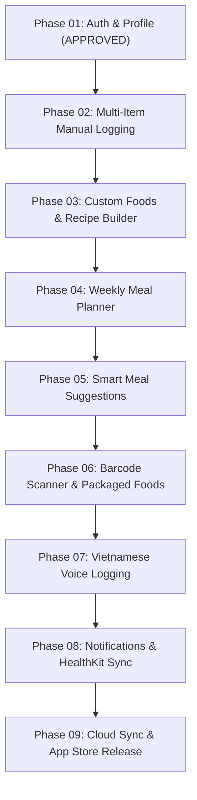

# NutriLens V1.0 — Comprehensive Recovery & Development Roadmap

**Document ID:** `reports/nutrilens_recovery_roadmap.md`  
**Date:** November 10, 2026  
**Auditor Roles:** Principal iOS Engineer, SwiftUI Architect, Clean Architecture Specialist, Senior QA Engineer  
**Scope:** Phase-by-Phase Roadmap to Reconstruct All Lost NutriLens Features from Baseline (Phase 01 Sign-off) to Production Release (Phase 09)  
**Execution Policy:** Sequential, Verified, Non-Destructive, Test-Driven Progression

---

## 1. Executive Roadmap Overview

Following the verification and sign-off of **Phase 00** (Core App & AI Inference) and **Phase 01** (Authentication & Account Security), the NutriLens iOS codebase stands on a clean, solid, and fully operational foundation with **65 automated tests passing (59 Unit, 6 UI)**.

This roadmap outlines the detailed sequence to reconstruct all remaining functional modules (Phases 02 through 08), concluding with backend integration and final App Store submission (Phase 09).

---

## 2. Phase-by-Phase Reconstruction Specifications

### Phase 02: Advanced Multi-Item Manual Logging & Enhanced Tracking
* **Objective:** Replace the legacy single-item English form ([`LogMealView.swift`](file:///Users/vanquyen/Documents/NutrilensIOS/NutriLens/Features/MealTracking/LogMealView.swift)) with a comprehensive multi-item manual food logging interface styled in Fresh Premium Botanical design.
* **Key Deliverables:**
  1. **Multi-Item Cart System:** Allow users to stage and log multiple food items within a single meal session (e.g. Rice + Fish + Soup + Fruit).
  2. **Direct Vietnamese Food Search:** Integrate live search against [`VietnameseNutritionDatabase.swift`](file:///Users/vanquyen/Documents/NutrilensIOS/NutriLens/Data/Repositories/VietnameseNutritionDatabase.swift) directly within manual logging.
  3. **Custom Item Creation:** Quick inline entry of unlisted items with instant macro and calorie calculation.
  4. **Date & Meal Type Picker:** Log meals for past dates or upcoming meal slots with native date wheel/picker.
  5. **Measurement Unit Integration:** Connect `useMetricUnits` from Settings to dynamically format grams vs ounces.
  6. **SwiftData Hydration Model:** Introduce `WaterRecordSDModel` and historical hydration queries in `NutritionAnalyticsView`.
  7. **Analytics Empty State Routing:** Connect the empty state action in `NutritionAnalyticsView` to switch tabs to Food Logging.
* **Target Test Target:** +15 Unit Tests (`MealLoggingV2Tests`), +2 UI Tests.

---

### Phase 03: Custom Foods, Ingredients & Recipe Builder
* **Objective:** Enable users to create reusable custom food items and composite recipes (dishes made of multiple ingredients).
* **Key Deliverables:**
  1. **Domain Models:** `CustomFood`, `Recipe`, `RecipeIngredient`.
  2. **SwiftData Schema Migration:** `CustomFoodSDModel`, `RecipeSDModel` with clean versioned migration plan.
  3. **Repository Layer:** `CustomFoodRepositoryProtocol` & `RecipeRepositoryProtocol` with SwiftData implementations.
  4. **Recipe Builder UI:** Multi-step wizard allowing users to name a dish, add ingredients, specify preparation notes, and automatically aggregate total and per-serving macronutrients.
  5. **Catalogue Integration:** Surface custom foods alongside canonical dishes in Food Explorer and Quick Add.
* **Target Test Target:** +18 Unit Tests (`RecipeBuilderTests`, `CustomFoodTests`).

---

### Phase 04: Weekly Meal Planner & Nutritional Budgeting
* **Objective:** Provide structured meal planning across a 7-day calendar, allowing users to pre-plan meals and adhere to their dietary goals.
* **Key Deliverables:**
  1. **Domain Models:** `MealPlan`, `PlannedMealItem`, `DailyPlanBudget`.
  2. **SwiftData Persistence:** `MealPlanSDModel` with relations to `FoodItemSDModel` and `RecipeSDModel`.
  3. **Planning UI:** Interactive weekly calendar grid with morning, afternoon, evening, and snack slots.
  4. **Budgeting Engine:** Real-time calorie and macro forecast against the user's `UserProfile` calorie target.
  5. **One-Tap Logging:** Convert planned meals into actual logged meals with a single confirmation tap.
* **Target Test Target:** +16 Unit Tests (`MealPlannerTests`), +2 UI Tests.

---

### Phase 05: Smart Meal Suggestions & Macro-Deficit Recommendation Engine
* **Objective:** Provide automated on-device meal recommendations to help users fulfill remaining daily calorie and macronutrient budgets.
* **Key Deliverables:**
  1. **Macro Deficit Calculator:** Calculates remaining daily allowances (`caloriesNeeded`, `proteinNeeded`, `carbNeeded`, `fatNeeded`).
  2. **Dietary Constraint Filtering:** Automatically filters candidate dishes based on user allergies and diet preferences (from `PreferencesView`).
  3. **Recommendation Algorithm:** Score candidate dishes from the 35+ Vietnamese database and custom recipes to find the closest macro-complementary match.
  4. **Suggestion Carousel:** Interactive card carousel on Home Dashboard presenting smart suggestions with "Thêm món này" CTA.
* **Target Test Target:** +14 Unit Tests (`MealSuggestionEngineTests`).

---

### Phase 06: Barcode Scanner & Packaged Food Database
* **Objective:** Instant nutritional recognition for packaged Vietnamese and international consumer goods via barcode scanning.
* **Key Deliverables:**
  1. **AVFoundation Capture:** Hardware-accelerated `AVCaptureMetadataOutput` scanning EAN-13, EAN-8, UPC-A, UPC-E barcodes.
  2. **Barcode Scanner UI:** Native camera overlay with aiming reticle, torch toggle, and haptic feedback.
  3. **Offline Barcode Cache:** SwiftData `PackagedFoodSDModel` storing frequently scanned local items.
  4. **OpenFoodFacts Integration:** HTTP client querying OpenFoodFacts REST API with caching and error handling.
  5. **Manual Barcode Entry:** Fallback numeric keypad for damaged or unreadable barcodes.
* **Target Test Target:** +16 Unit Tests (`BarcodeScannerTests`).

---

### Phase 07: Vietnamese Voice Food Logging
* **Objective:** Hands-free meal logging using natural language voice input in Vietnamese (e.g. *"Tôi ăn một bát bún chả và uống một ly nước mía"*).
* **Key Deliverables:**
  1. **Speech Recognition:** `SFSpeechRecognizer` configured for Vietnamese locale (`vi-VN`) with permission handling.
  2. **Audio Engine:** `AVAudioEngine` for real-time speech waveform visualization.
  3. **Vietnamese NLP Parsing:** Rule-based and keyword-driven entity extraction identifying dish name, quantity (*"một bát"*, *"hai đĩa"*, *"nửa ổ"*), and meal category.
  4. **Review & Confirm Sheet:** Botanical preview sheet showing parsed items for user validation before saving to SwiftData.
* **Target Test Target:** +12 Unit Tests (`VoiceLoggingNLPTests`).

---

### Phase 08: Local Notifications, Backup & HealthKit Integration
* **Objective:** Enhance user engagement, system integration, and data portability.
* **Key Deliverables:**
  1. **Notification Scheduling:** `UNUserNotificationCenter` service triggering smart meal reminders according to user preferences in Settings.
  2. **Apple HealthKit Sync:** Bi-directional sync exporting Dietary Energy, Protein, Carbohydrates, Total Fat, and Water to Apple Health (`HKHealthStore`).
  3. **Complete Backup & Restore:** Encrypted JSON backup file export/import through iOS Document Picker.
* **Target Test Target:** +14 Unit Tests (`NotificationServiceTests`, `HealthKitSyncTests`).

---

### Phase 09: Cloud Backend Integration & App Store Release QA
* **Objective:** Enable optional multi-device synchronization and finalize production release requirements.
* **Key Deliverables:**
  1. **Backend Sync:** Optional Supabase / CloudKit integration for synchronized meal logs and user profiles with user consent.
  2. **Production Code Signing & Entitlements:** App Store distribution provisioning, App Groups, Keychain access groups.
  3. **Final Security & Privacy Audit:** Comprehensive validation against Apple App Store Review Guidelines 2.1, 5.1.1, and 5.1.2.
  4. **Performance Profiling:** Memory leaks check via Xcode Instruments, Core ML latency optimization (<100ms on A16+).
* **Target Test Target:** Complete suite regression testing (>160 tests).

---

## 3. Risk Assessment & Mitigation Matrix

| Risk Factor | Likelihood | Impact | Mitigation Strategy |
| :--- | :---: | :---: | :--- |
| **SwiftData Schema Migration Breakage** | Medium | Critical | Implement explicit `VersionedSchema` and `SchemaMigrationPlan` for any model alterations in Phase 03. |
| **Hardware Camera / Simulator Divergence** | Low | Medium | Maintain simulation mocks in `CameraService` and `BarcodeService` to permit continuous automated CI/CD testing. |
| **Speech Framework Network Dependency** | Medium | Medium | SFSpeechRecognizer requires on-device dictation capability; provide immediate text fallback if dictation is unavailable. |
| **Nutritional Disclaimers & App Store Rejection** | Low | High | Maintain prominent Medical Disclaimers in `SettingsView` and onboarding; ensure AI outputs are labeled as estimates. |
| **Background Thread Persistence Crashes** | Low | High | Ensure all SwiftData mutations occur through actor-isolated ModelContext or MainActor repositories. |

---

## 4. Recommended Next Development Action

The recommended next technical task is to **begin Phase 02 Development**:
1. Rebuild [`NutriLens/Features/MealTracking/LogMealView.swift`](file:///Users/vanquyen/Documents/NutrilensIOS/NutriLens/Features/MealTracking/LogMealView.swift) as a **Multi-Item Vietnamese Botanical Logging View**.
2. Connect `VietnameseNutritionDatabase` search directly to the manual logging flow.
3. Add a dedicated date picker and meal type selector.
4. Introduce unit conversion formatting and write corresponding unit tests.

